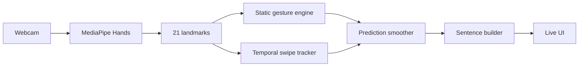

# SignFlow — Live Hand Sign Recognition

A portfolio-grade **real-time hand gesture product** that combines browser webcam capture, MediaPipe hand landmarks, a Python gesture engine, dynamic gesture tracking, temporal smoothing and a sentence builder.

## What makes this a product
- live webcam input using MediaPipe Hands in the browser
- 21-landmark inference endpoint
- static vocabulary: open palm, fist, point, V sign, thumbs-up and I-love-you gesture
- dynamic swipe-left / swipe-right recognition using wrist trajectory
- temporal prediction smoothing to reduce frame-to-frame flicker
- gesture-to-word sentence builder with repeat/debounce controls
- polished responsive UI
- Flask API, Docker packaging, product tests and CI

## Run
```bash
pip install -r requirements.txt
python app.py
```
Open `http://localhost:5000` and allow camera access. The page loads MediaPipe browser assets from jsDelivr.

## Pipeline


## Scope and integrity
This project demonstrates gesture-recognition engineering and accessible interaction design. It is **not** a certified sign-language translator: natural sign languages include hand shape, orientation, movement, location, facial expression, body posture and grammar that a small gesture vocabulary does not capture. A research extension would require a labelled sign-language dataset, signer-independent evaluation and temporal sequence models.
