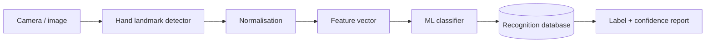

# Hand Sign Recognition

A complete machine-learning/computer-vision portfolio system for normalising hand landmarks, extracting scale/translation-invariant features, classifying hand signs and persisting recognition sessions for audit and evaluation.

## Included
- hand-landmark normalisation and feature extraction
- nearest-prototype ML baseline
- synthetic sign examples
- SQLite persistence for sessions, classes, detections and feature summaries
- ER/data-flow diagrams
- automated feature/classification/storage tests
- CI
- API/interface, deployment, security and model-card documentation
- full technical report

## Architecture


## Run
```bash
python demo.py
python -m unittest discover -s tests -v
```

## Database
```bash
python -c "from src.storage import init_db; init_db('handsigns.db', seed=True)"
```

The repository implements the feature/classification and persistence layers without claiming trained-camera benchmark accuracy. A full CV version would connect the pipeline to a hand detector such as MediaPipe and a validated trained classifier.
