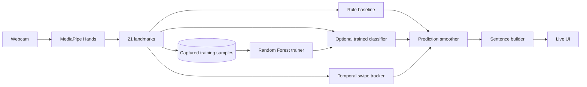

# SignFlow — Live Hand Sign Recognition

[](https://github.com/rsswethaa/hand-sign-recognition/actions/workflows/ci.yml)

A portfolio-grade real-time hand-gesture product that combines browser webcam capture, MediaPipe hand landmarks, a Python gesture engine, dynamic gesture tracking, temporal smoothing, a sentence builder and an optional classifier trained from captured samples.

## Product capabilities
- live webcam input using MediaPipe Hands in the browser
- 21-landmark inference endpoint
- static demo vocabulary: open palm, fist, point, V sign, thumbs-up and I-love-you gesture
- dynamic swipe-left / swipe-right recognition using wrist trajectory
- temporal prediction smoothing to reduce frame-to-frame flicker
- sign → word → sentence builder with repeat/debounce controls
- in-product labelled landmark sample capture
- Random Forest training pipeline for real captured samples
- automatic learned-model inference when `models/gesture_classifier.joblib` exists
- transparent rule-engine fallback
- responsive UI, Flask API, Docker packaging, tests and CI
- accessibility and responsible-use documentation

## Architecture


## Run the live product
```bash
python -m venv .venv
source .venv/bin/activate  # Windows: .venv\Scripts\activate
pip install -r requirements.txt
python app.py
```
Open `http://localhost:5000`, allow camera access and start signing. MediaPipe browser assets are loaded from jsDelivr.

## Train on captured samples
Use the **Collect real training samples** panel in the live UI to record labelled examples.

```bash
pip install -r requirements-training.txt
python training/train_classifier.py training_data/landmarks.jsonl
```

The trainer saves `models/gesture_classifier.joblib` and prints a holdout confusion matrix and classification report. Restart the app and it will automatically prefer the learned model for static gestures.

For credible evaluation, collect multiple examples across different people, positions, lighting conditions and backgrounds, and separate signers between training and testing.

## API
- `POST /api/predict` — static + dynamic gesture inference
- `POST /api/training/sample` — save a labelled 21-landmark example
- `GET /api/training/status` — captured sample counts and trained-model status
- `POST /api/sentence/clear` — clear phrase
- `POST /api/sentence/space` — allow a repeated word
- `GET /health` — service/model status

## Repository structure
```text
app.py                    live product API
static/, templates/       webcam UI
src/gesture_engine.py     static rules, dynamics, smoothing and sentence builder
src/learned_classifier.py optional learned model adapter
src/sample_store.py       captured landmark storage
src/features.py           scale/translation-invariant features
training/                 classifier training pipeline
training_data/            local captured samples; ignored by Git
models/                   local trained model artifact; ignored by Git
database/                 recognition audit schema and SQL
tests/                    feature, storage, product and training-data tests
docs/                     architecture, API, training, accessibility, security, model card and report
```

## Accessibility use case
SignFlow demonstrates how camera-based hand input could support accessible or hands-free interaction. It includes visual feedback and a sentence builder, but it is not a certified sign-language translator. Natural sign languages include orientation, movement, location, facial expression, body posture, spatial grammar and community-specific linguistic conventions.

## What I learned
This project demonstrates browser computer vision, hand-landmark geometry, temporal recognition, data collection, ML training, explainable fallback design, accessibility considerations, Flask APIs, Docker and CI.

## Integrity note
The repository does not claim sign-language translation accuracy or a trained-model benchmark until real labelled samples are collected and evaluated. The built-in rules exist so the product remains reproducible before a trained artifact is available.
