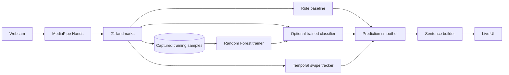

# SignFlow — Live Hand Sign Recognition

**Status: Accessibility-oriented computer-vision prototype**

[](https://github.com/rsswethaa/hand-sign-recognition/actions/workflows/ci.yml)

**[Live Demo](https://swethaa-signflow.onrender.com) · [Architecture](docs/ARCHITECTURE.md) · [Training Guide](docs/TRAINING.md) · [Accessibility](docs/ACCESSIBILITY.md)**

SignFlow explores real-time hand input using browser webcam capture, MediaPipe hand landmarks, temporal gesture tracking and an optional classifier trained from captured examples.

## What it does

- captures live webcam input in the browser
- receives 21 MediaPipe hand landmarks per frame
- recognises a small static demo vocabulary
- tracks dynamic swipe-left / swipe-right motion from wrist trajectory
- smooths predictions across frames to reduce flicker
- builds words into a simple sentence stream with debounce controls
- collects labelled landmark samples in-product
- trains a Random Forest classifier from captured examples
- automatically uses a trained model when `models/gesture_classifier.joblib` exists
- falls back to transparent geometric rules when no model is available
- runs with Flask, Docker, automated tests and CI

## Why a rule baseline and a trained path?

A rule baseline makes the interaction reproducible before a dataset exists and makes geometry failures visible. The trained path becomes meaningful only after enough labelled examples are collected across different people, positions and conditions.

## Architecture



## Run locally

```bash
python -m venv .venv
source .venv/bin/activate  # Windows: .venv\Scripts\activate
pip install -r requirements.txt
python app.py
```

Open `http://localhost:5000`, allow camera access and start signing.

## Train on captured samples

Use the **Collect real training samples** panel in the UI, then run:

```bash
pip install -r requirements-training.txt
python training/train_classifier.py training_data/landmarks.jsonl
```

The trainer writes `models/gesture_classifier.joblib` and reports a holdout confusion matrix/classification report.

For a credible experiment, collect examples across multiple signers and environments and keep signers separated between training and evaluation.

## API

- `POST /api/predict` — static + dynamic inference
- `POST /api/training/sample` — save a labelled landmark example
- `GET /api/training/status` — sample counts and model status
- `POST /api/sentence/clear` — clear the phrase
- `POST /api/sentence/space` — allow a repeated word
- `GET /health` — service/model status

## Accessibility boundary

SignFlow demonstrates how camera-based hand input could support accessible or hands-free interaction. It is **not a certified sign-language translator**. Natural sign languages include orientation, movement, location, facial expression, body posture, spatial grammar and community-specific linguistic conventions that are far richer than this prototype vocabulary.

## Evaluation integrity

The repository does not claim sign-language translation accuracy or a trained-model benchmark until real labelled samples are collected and evaluated. The built-in rules exist so the product remains inspectable and reproducible before a trained artifact is available.
