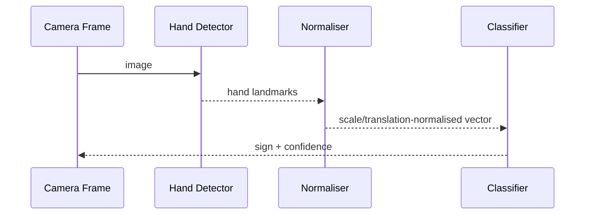

# Architecture

The current repository implements deterministic feature processing and a nearest-prototype ML baseline. A full camera application can replace the detector boundary with MediaPipe Hands or another keypoint model and train an SVM, random forest or neural classifier on labelled gestures.
