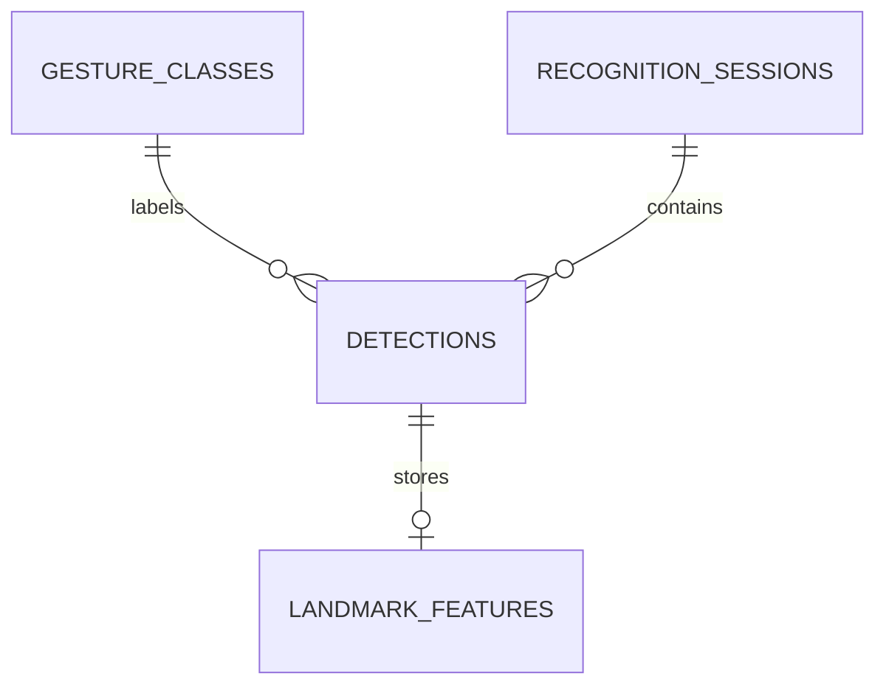

# Database Design

## Tables
- `gesture_classes`: controlled label catalogue.
- `recognition_sessions`: image/video/camera analysis session.
- `detections`: frame-level predicted label, confidence and model version.
- `landmark_features`: serialised normalised feature vector and landmark count.

Keeping model version and features with each detection makes later analysis and comparison possible.
